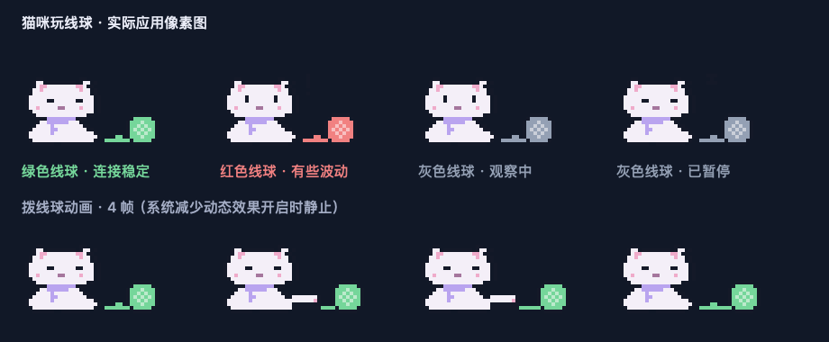

# Claude 小哨兵

macOS 菜单栏网络观察工具，深蓝与淡紫像素空间站风格，使用猫咪玩线球显示连接状态：绿色正常、红色异常、灰色未确认或暂停。原生 SwiftUI / AppKit，无第三方运行时依赖。



## 构建与运行

需要 macOS 14+ 和 Swift 6 工具链。

```sh
./scripts/build.sh
open output/ClaudeSentinel.app
```

启动时打开详情窗口，之后点击菜单栏猫咪。关闭窗口后仍在菜单栏运行；在弹窗底部退出。默认约每30秒轻量检查 API 与出口，每五分钟完整检测一次，可以暂停或手动刷新。网络变化和 Mac 唤醒后补查；休眠期间不检测。不自动注册开机启动。

```sh
.build/release/ClaudeSentinel --self-test
.build/release/ClaudeSentinel --probe
```

`--probe` 输出一次真实检测 JSON；代理或 API 连通检查失败时退出码为 2。它不写入图形界面的历史记录。

## 猫咪状态

| 状态 | 依据 |
| --- | --- |
| 检查中 | 尚无结果，正在首次检测 |
| 观察中 | 样本不足三次，或记录已经过期 |
| 连接稳定 | 最近最多六次新连通检查均成功，出口相同，响应波动未超过阈值 |
| 有些波动 | 最近失败、DNS异常、UDP出口不一致、网页出口变化，或响应标准差超过 max(300ms, 均值的40%) 且极差超过500ms |
| 连接中断 | 当前代理与 API 都失败，或 API 连续两次不可达 |
| 已暂停 | 用户暂停自动检查，保留旧结果 |

单次成功只说明当前连通；“稳定”是短时观测，不是 SLA 或账号安全评级。HTTP 403/429 会显示需留意，不直接当作物理断网。

## 实测范围

- 显式通过配置的 HTTP 代理请求 Cloudflare trace，显示该服务观测到的出口。不声称这是 Anthropic 所见的 IP。
- 匿名 GET Anthropic API，测量首字节响应时间；401/404/405 等可说明到达服务端，不证明模型权限或登录有效。
- 通过 Mihomo Unix Socket 只读获取前置选择链、TUN 与 IPv6 开关。
- 向本机 DNS 发送 TXT 查询，同时读取 Clash Verge 当前上游配置；不将配置正确等同完整的权威 DNS 泄露检测。
- STUN 检查系统路由下的 UDP IPv4，并与网页出口比较。超时显示未知，不误报已经泄露。它不能代替 Chrome WebRTC 测试。
- 读取当前 macOS 网络服务的 IPv6 开关；不推断未来新增接口。
- `claude auth status` 仅保留登录布尔结果，不把本地登录记录当作 OAuth 有效证明，不发送模型请求。
- 官方服务状态、公开 IP 地区及运营商资料（缓存六小时）、本机时区和语言。
- 浏览器字体、Canvas、WebGL、WebRTC 等明确标为需要在浏览器另测，并提供外部检测入口。

没有 IP 风险付费数据库，所以不编造住宅/独享标签、滥用历史或“100分”。本工具无法预测 KYC、账号处罚或确认实际使用地区是否符合服务要求。

## 默认配置与适配

- HTTP 代理：`http://127.0.0.1:7890`
- Mihomo Socket：`/tmp/verge/verge-mihomo.sock`
- 本地 DNS：`127.0.0.1:1053`
- 前置组：`前置节点自动切换`，递归解析当前所选子组。

默认适配 Clash Verge Rev；请按自己的代理客户端在设置中调整路径和端口。DNS 上游配置的读取路径为 Clash Verge Rev 的标准 Application Support 目录。

## 数据与隐私

历史最多96条，保存在 `~/Library/Application Support/ClaudeSentinel/`，目录权限700、文件600。保留 IP、节点名称和检测摘要；隐藏 IP 开关会遮盖界面和复制报告中的地址，但不会删除历史文件中的 IP。

网络检查会联系 Cloudflare、Anthropic、Google STUN，以及可选 IPinfo。浏览器测试按钮由用户主动打开第三方页面。应用不上传历史，不提取订阅密码或登录 token，不更改代理、系统网络、时区或 shell 配置。

本地构建使用临时签名，没有 Apple 公证；发布给其他用户需要开发者签名与公证。生成的应用位于 output/，该目录不纳入版本控制。

## 持续监控与线球

- 绿色：最近至少三次新连通样本正常，出口一致，完整 DNS/UDP 检查没有明确异常。
- 红色：连通异常、响应明显波动、出口变化、DNS 失败或 UDP 出口不一致；点击猫咪看原因。
- 灰色：刚启动、观察中、检查结果过期、暂停或休眠。登录提示独立显示，线球只表示网络监控。
- 约每30秒发起两个很小的匿名 HTTPS 请求（API 与 Cloudflare），每五分钟补全其余检查；无模型调用，不消耗 Claude token。可以选择15/30/60秒。
- 网络请求有超时，故障发现不是零延迟；默认可能需要约30–45秒。
- 猫咪每半秒切换一个拨线球帧，异常和暂停时停止玩耍；启用 macOS“减少动态效果”时使用静态图标。
- 轻量记录仅保留最近六条于内存；磁盘历史仍保存完整检查，最多96条。重新启动、网络切换和唤醒时重新积累样本，不用旧的绿色状态冒充当前正常。

生成实际像素渲染预览：

```sh
.build/release/ClaudeSentinel --render-mascot /tmp/mascot.png
```
